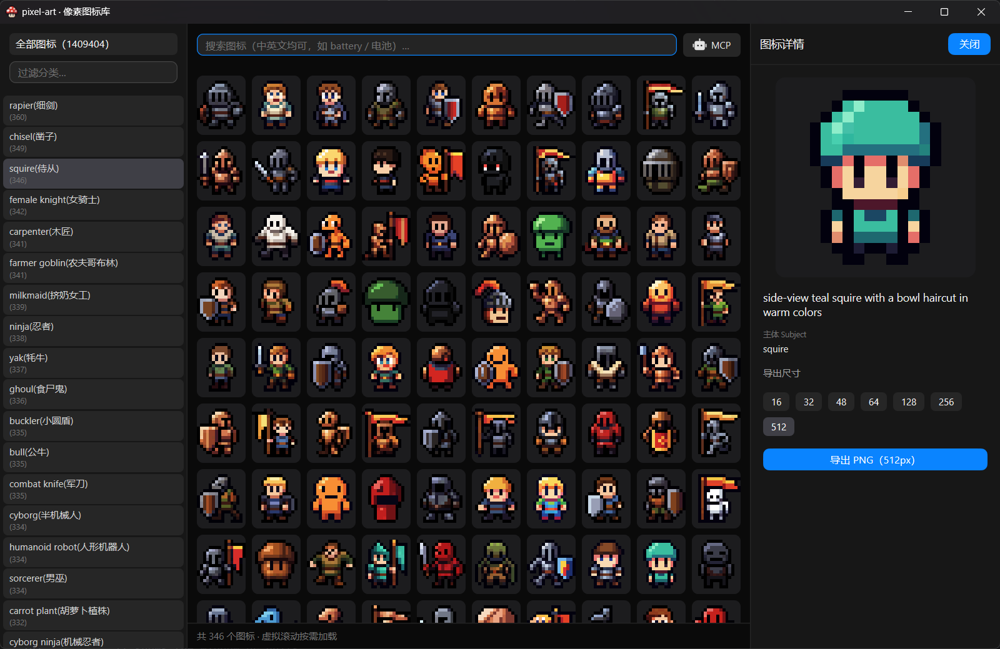
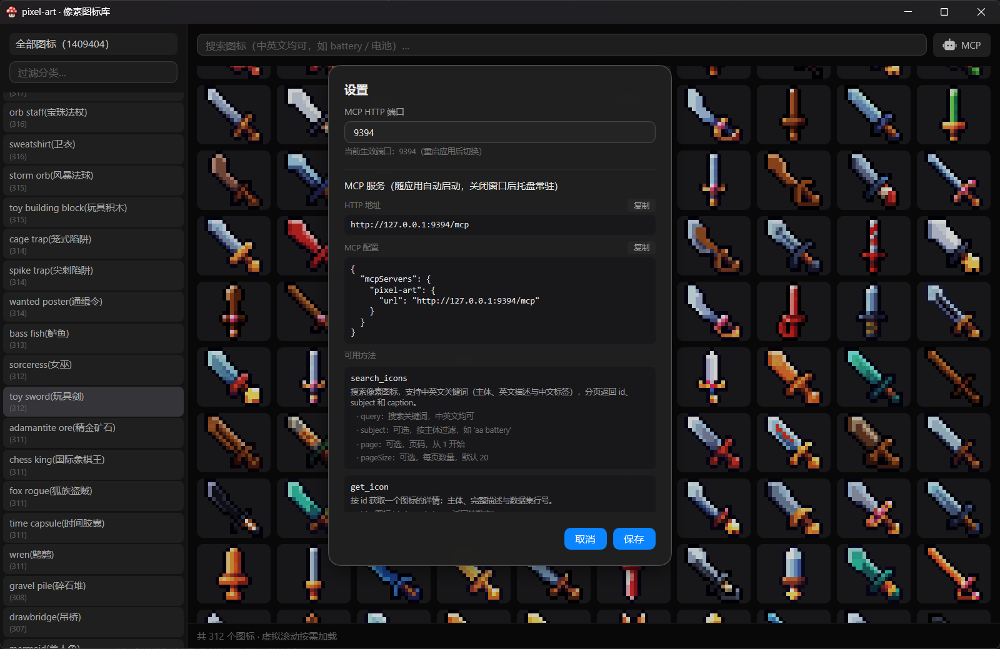

<p align="center">
  
</p>

<h1 align="center">pixel-art · 像素图标库</h1>

<p align="center"><a href="README_EN.md">English</a> | 中文</p>

<p align="center">
  <a href="https://github.com/limengwei/pixel-art/releases/latest"></a>
</p>

<p align="center">
基于 <a href="https://huggingface.co/datasets/Angais/pixel-art-atlas-1.4m">Pixel Art Atlas</a> 数据集的像素图标浏览器与检索工具——140 万个游戏精灵图。<br>
内置中英文全文搜索索引，集成 MCP 服务器可接入 AI 助手使用。
</p>

## 截图

<p align="center">
  
</p>
<p align="center">
  
</p>

## 功能特性

- **图标浏览** — 虚拟滚动网格，按需从 `tokens.npy` 渲染精灵图，流畅浏览全部 1,409,404 个图标
- **中英文搜索** — 内置 SQLite + FTS5 全文索引，英文描述与中文标签均可检索（如 `battery` / `电池`）
- **分类侧栏** — 6,194 个主题分类，中英双语显示，支持中文过滤
- **详情与导出** — 任意尺寸放大预览，PNG 一键导出
- **MCP 服务** — 内嵌 MCP 服务器（stdio + HTTP），供 AI 工具（IDE、助手等）直接检索和导出图标
- **托盘常驻** — 关闭窗口最小化到系统托盘，MCP 服务后台继续运行

## 技术栈

| 层级 | 技术 |
|------|------|
| 语言 | Go |
| 桌面框架 | [nsgo](https://github.com/nsgo-dev/nsgo)（暗色外观、托盘、启动页） |
| 数据库 | SQLite (modernc.org/sqlite)、FTS5 |
| 数据集 | `tokens.npy` + `palette.npy` 按需渲染 |
| MCP | [modelcontextprotocol/go-sdk](https://github.com/modelcontextprotocol/go-sdk) |

## 数据集（pixel-art-16x16-1.4m）

应用仅支持这一个数据集：

- 1,409,404 个透明背景的合成游戏精灵图，覆盖 6,194 个主题分类，附带英文描述
- 图像由 Krea 2 Turbo 与像素画 LoRA 从文本提示生成，以 CC0 1.0 协议发布
- `tokens.npy` 存储 256 个调色板索引（行主序），索引 0 为透明，其余索引从 `palette.npy` 取 RGB 颜色
- 描述为生成时的提示词，与图像内容大致对应但不完全精确（颜色、数量、细节可能有出入），使用时请以图像为准
- 原始数据集共 1,412,908 张，过滤后保留 1,405,308 张训练图与 4,096 张验证图

## 首次启动

首次打开（或数据不完整）时会出现欢迎页，展示数据集横幅与介绍。点击「部署数据集」，应用会一键完成三步（仅需一次，数据集已存在时自动跳过前两步）：

1. 从 Hugging Face 下载数据集压缩包（约 253 MB，解压后约 770 MB）——优先走 [hf-mirror.com](https://hf-mirror.com) 国内镜像，失败自动回退官方源
2. 自动解压到缓存目录
3. 构建搜索索引（约 3–5 分钟，索引约 211 MB）

```
https://huggingface.co/datasets/Angais/pixel-art-atlas-1.4m/resolve/main/pixel-art-16x16-1.4m.zip?download=true
```

数据集与索引的固定位置：

| 内容 | 路径（Windows） |
| --- | --- |
| 搜索索引（部署时构建） | `%LocalAppData%\pixelart\icons.db` |
| 数据集目录 | `%LocalAppData%\pixelart\pixel-art-16x16-1.4m\` |

部署完成后会生成 `manifest.json`（SHA-256 清单）用于后续启动的内容校验；老版本部署的数据在下次启动通过大小校验后会自动补生成。若索引或数据集缺失，启动时会重新检测并展示欢迎页，重新点「部署数据集」即可修复（重建索引是幂等的）。

## MCP 集成

启动后自动在本机开启 MCP HTTP 服务（默认端口 9394）。工具栏「MCP」按钮打开设置页，可查看/复制接入地址、客户端 JSON 配置与工具文档，端口可修改、重启生效。另可用 `pixel-art.exe --mcp` 以 stdio 模式独立运行。

**关闭主窗口不会退出程序**：应用最小化到系统托盘继续提供 MCP 服务，单击托盘图标恢复窗口，托盘右键菜单可选择「显示窗口」或「退出」。

### 可用工具

| 工具 | 说明 |
|------|------|
| `search_icons` | 按中文或英文关键词搜索像素图标（匹配主体、英文描述与中文标签），支持主体过滤与分页，返回 `id`、`subject`、`caption` |
| `get_icon` | 按 id 获取图标详情：主体、完整描述、原始尺寸与数据集行号 |
| `export_icon` | 导出图标为 PNG 文件（从数据集按需渲染，最近邻采样保持像素锐利），可指定尺寸与输出目录，返回导出文件绝对路径 |

### 客户端配置

将以下内容添加到 MCP 客户端配置中（如 Claude Desktop、Cursor）：

```json
{
  "mcpServers": {
    "pixel-art": {
      "url": "http://127.0.0.1:9394/mcp"
    }
  }
}
```

## 构建与开发

```bash
go build -trimpath -ldflags "-s -w" -o pixel-art.exe .
go test ./internal/...
```

### 重建索引

搜索索引由 `internal/indexer` 从数据集的 `captions.json` / `objects.json` 构建（INSERT OR REPLACE，幂等可重跑）。删除缓存中的 `icons.db` 后重启应用，欢迎页会引导重新部署；也可以在测试中直接调用 `indexer.Run` 构建到指定数据库。

## 许可

- 代码：本项目自有版权
- 数据集：[CC0 1.0](https://creativecommons.org/publicdomain/zero/1.0/)，由 Angais 发布；精灵图为 AI 生成物，不含模型权重
