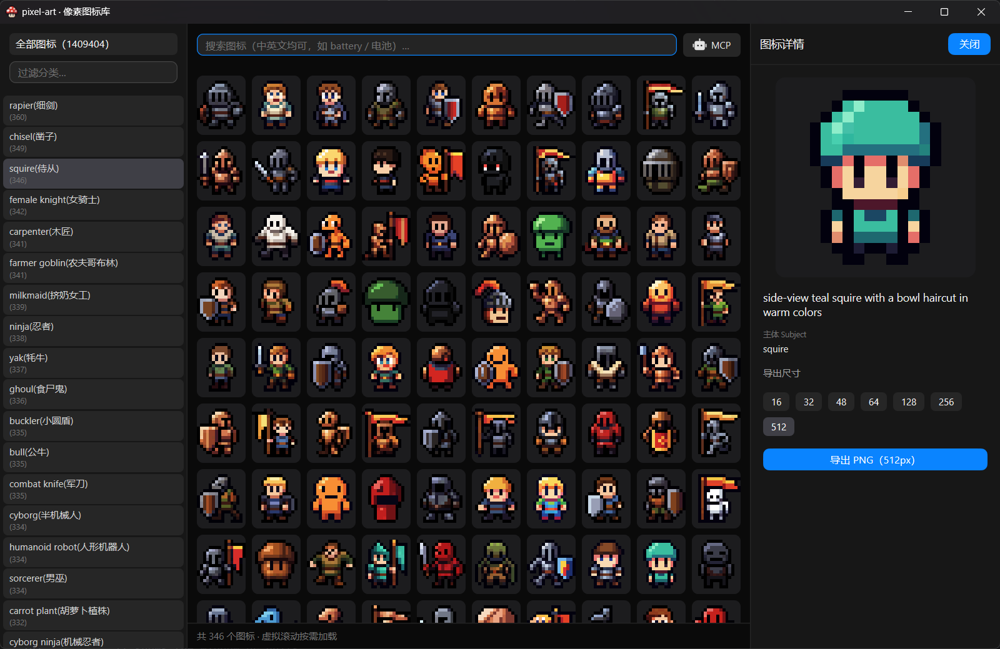
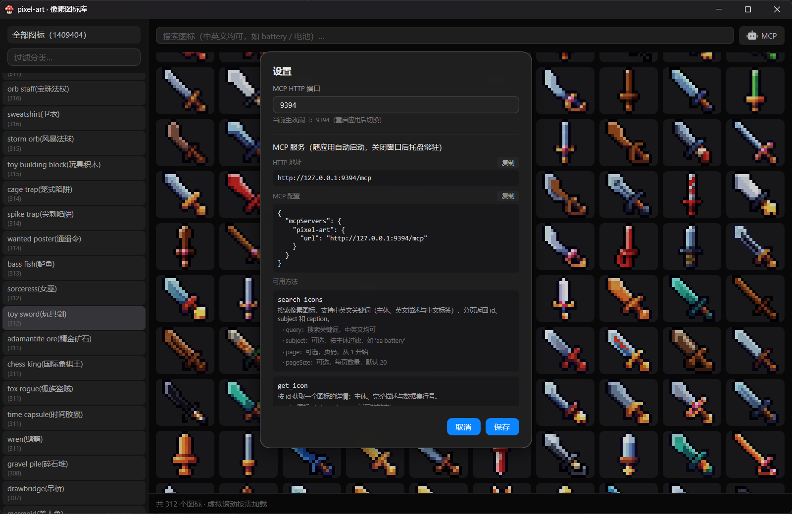

<p align="center">
  
</p>

<h1 align="center">pixel-art</h1>

<p align="center">English | <a href="README.md">中文</a></p>

<p align="center">
  <a href="https://github.com/limengwei/pixel-art/releases/latest"></a>
  <a href="https://github.com/limengwei/pixel-art/releases"></a>
</p>

<p align="center">
A pixel-art icon browser and search tool over the <a href="https://huggingface.co/datasets/Angais/pixel-art-atlas-1.4m">Pixel Art Atlas</a> dataset — 1.4 million game sprites.<br>
Built-in bilingual (EN/中文) full-text search index and an MCP server for AI assistant integration.
</p>

## Screenshots

<p align="center">
  
</p>
<p align="center">
  
</p>

## Features

- **Icon Browsing** — Virtual-scrolling grid that renders sprites on demand from `tokens.npy`; browse all 1,409,404 icons smoothly
- **Bilingual Search** — Built-in SQLite + FTS5 full-text index; search by English caption or Chinese label (e.g. `battery` / `电池`)
- **Category Sidebar** — 6,194 topic categories shown in both English and Chinese, with Chinese filtering
- **Detail & Export** — Zoomed preview at any size, one-click PNG export
- **MCP Server** — Embedded MCP server (stdio + HTTP) for AI tools (IDEs, assistants) to search and export icons
- **Tray Resident** — Closing the window minimizes to the system tray; the MCP server keeps running in the background

## Tech Stack

| Layer | Technology |
|-------|-----------|
| Language | Go |
| Desktop Framework | [nsgo](https://github.com/nsgo-dev/nsgo) (dark appearance, tray, splash) |
| Database | SQLite (modernc.org/sqlite), FTS5 |
| Dataset | `tokens.npy` + `palette.npy`, rendered on demand |
| MCP | [modelcontextprotocol/go-sdk](https://github.com/modelcontextprotocol/go-sdk) |

## Dataset (pixel-art-16x16-1.4m)

The app supports this single dataset:

- 1,409,404 transparent-background synthetic game sprites across 6,194 topic categories, each with an English caption
- Images generated by Krea 2 Turbo with a pixel-art LoRA from text prompts, released under CC0 1.0
- `tokens.npy` stores 256 palette indices per sprite (row-major); index 0 is transparent, other indices map to RGB via `palette.npy`
- Captions are the generation prompts — roughly but not exactly accurate (colors, counts, details may differ); trust the image
- The original dataset holds 1,412,908 images; after filtering, 1,405,308 training and 4,096 validation images remain

## First Launch

On first launch (or when data is incomplete), a welcome page shows the dataset banner. Click **Deploy Dataset** and the app completes three steps in one click (only once; the first two are skipped if the dataset already exists):

1. Download the dataset archive from Hugging Face (~253 MB zip, ~770 MB extracted) — via the [hf-mirror.com](https://hf-mirror.com) mirror first for mainland-China speeds, falling back to the official source
2. Extract it to the cache directory
3. Build the search index (~3–5 minutes, ~211 MB)

```
https://huggingface.co/datasets/Angais/pixel-art-atlas-1.4m/resolve/main/pixel-art-16x16-1.4m.zip?download=true
```

Fixed locations:

| Content | Path (Windows) |
| ------- | -------------- |
| Search index (built on deploy) | `%LocalAppData%\pixelart\icons.db` |
| Dataset directory | `%LocalAppData%\pixelart\pixel-art-16x16-1.4m\` |

A `manifest.json` (SHA-256 listing) is generated after deploy for integrity checks on later launches; older deployments get it backfilled automatically after a size check. If the index or dataset goes missing, the welcome page reappears on startup — click **Deploy Dataset** again to repair (index building is idempotent).

## MCP Integration

The embedded MCP HTTP server starts automatically (default port 9394). The toolbar **MCP** button opens a settings page with the endpoint URL, ready-to-copy client JSON, and tool docs — the port can be changed and takes effect after restart. Alternatively, run `pixel-art.exe --mcp` for a standalone stdio server.

**Closing the window does not quit the app**: it minimizes to the system tray and keeps serving MCP. Click the tray icon to restore the window; the tray right-click menu offers *Show* / *Quit*.

### Available Tools

| Tool | Description |
|------|-------------|
| `search_icons` | Search pixel icons by Chinese or English keyword (subject, English caption, or Chinese label), with subject filter and pagination; returns `id`, `subject`, `caption` |
| `get_icon` | Get one icon's details by id: subject, full caption, original size, and dataset row |
| `export_icon` | Export an icon as PNG (rendered on demand, nearest-neighbor sampling to keep pixels crisp); custom size and output directory; returns the absolute path |

### Client Configuration

Add to your MCP client config (e.g. Claude Desktop, Cursor):

```json
{
  "mcpServers": {
    "pixel-art": {
      "url": "http://127.0.0.1:9394/mcp"
    }
  }
}
```

## Build & Development

```bash
go build -trimpath -ldflags "-s -w" -o pixel-art.exe .
go test ./internal/...
```

### Rebuilding the Index

The search index is built by `internal/indexer` from the dataset's `captions.json` / `objects.json` (INSERT OR REPLACE — idempotent, safe to re-run). Delete `icons.db` in the cache and restart to be guided through redeploying, or call `indexer.Run` directly in tests to build into a specific database.

## License

- Code: this project's own copyright
- Dataset: [CC0 1.0](https://creativecommons.org/publicdomain/zero/1.0/) by Angais; the sprites are AI-generated and contain no model weights
